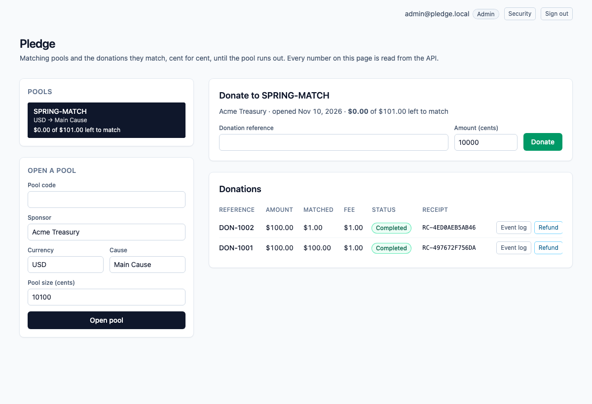
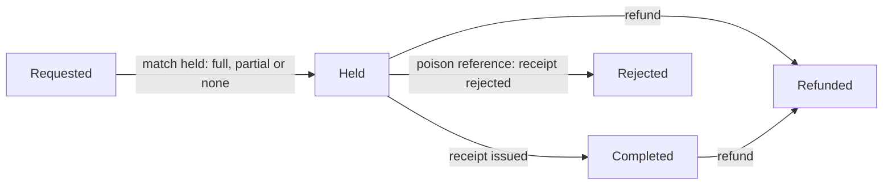
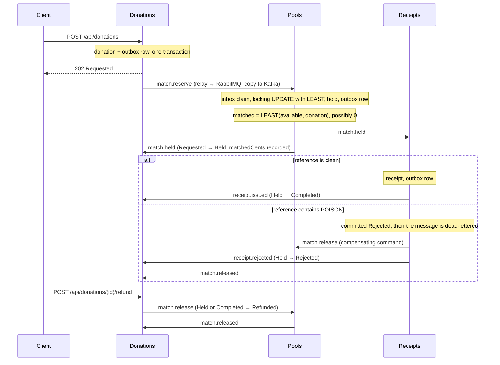
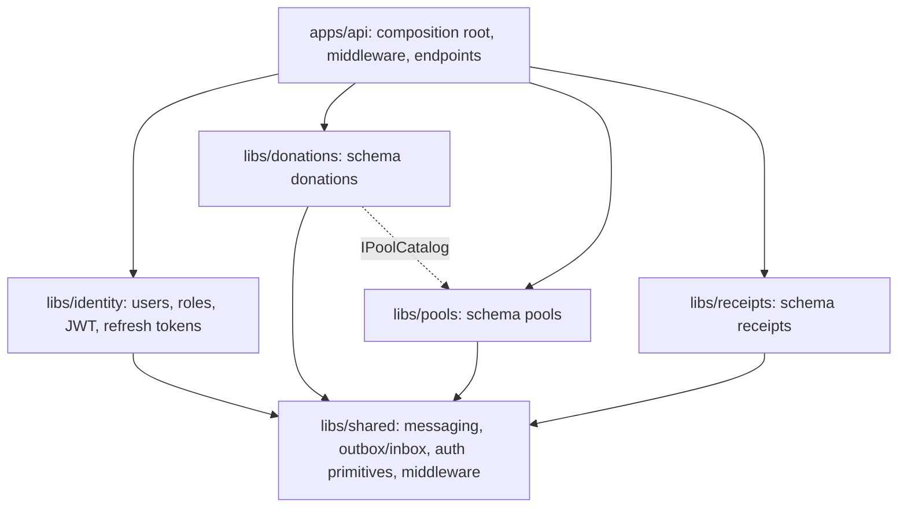

# dotnet-pledge

Matched donations. A sponsor puts a **matching pool** behind a cause, and every donation is matched cent for cent until the pool runs out. The scarce number is the pool's **available cents**, and the **Pools** module is its only writer. It takes `LEAST(available, donation)` in one locking statement, so a donation is matched **in full, in part, or not at all, never beyond what the pool has**, and the donation itself always goes through. When two donors fight for the last cents they share them (60 and 40 out of 100 left, in either order); twelve concurrent donations against a pool of 1,000 match exactly 1,000 between them. A donation reference that contains the poison token `POISON` is committed as rejected by the Receipts module, the message is dead-lettered, and a compensating command gives the matched cents back. A later refund also gives back exactly what was matched, but it does not roll back the receipt that was already issued.

One ASP.NET Core process, one Postgres database. An HTTP write saves the donation and an outbox row in one local transaction; a `BackgroundService` relay publishes outbox rows to RabbitMQ (the work queue) and Kafka (the event log); the next module consumes from RabbitMQ, claims an inbox key in the same transaction as its own write, and writes its own row and outbox row. Saga steps never call each other in-process. Delivery is at-least-once: the relay can publish and crash before it marks a row sent, so the row goes out again, and every consumer dedupes with its inbox key. Each saga step only moves a donation forward from the status it expects.

Everything behind the saga is signed in: **ASP.NET Core Identity** with **JWT access tokens and rotating refresh tokens** (see [Authentication and authorization](#authentication-and-authorization)). Customers see and refund only their own donations; staff see everything and open pools.

> The demo credentials in `compose.yaml` and `appsettings.Development.json` are for local use only. Set `JWT_KEY` and `ADMIN_PASSWORD` (see `.env.example`) before putting this anywhere shared. Compose binds every port to `127.0.0.1`.



*The UI reads everything from the API; shown signed in as the seeded administrator, on a pool of $101.00: the first donation was matched in full, the second only got the last $1.00, and the pool is empty.*

## Donation statuses



`Refunded` and `Rejected` (after a hold) give back the cents that were matched (possibly none) through a `ReleaseMatch` command, and Pools releases a hold at most once. The receipt has its own status (`Issued` or `Rejected`) and a refund never changes it. If the refund gets there before the final mark, the late mark finds the donation is no longer `Held` and does nothing.

## How the modules talk



| Module | Owns | Consumes | Emits |
| --- | --- | --- | --- |
| **Identity** (`libs/identity`) | `identity` schema: users, roles, refresh tokens. | | |
| **Donations** (`libs/donations`) | `Donations`: status, amount, matched cents, fee, reference. Validation, the poison rule, the fee. | `match.held`, `receipt.issued`, `receipt.rejected`, `match.released` | `match.reserve`, `match.release` (refund) |
| **Pools** (`libs/pools`) | `Pools.AvailableCents` (sole writer after the pool opens) and `MatchHolds` (what each donation was matched). | `match.reserve`, `match.release` (prefetch 1) | `match.held`, `match.released` |
| **Receipts** (`libs/receipts`) | `Receipts`. | `match.held` | `receipt.issued`, `receipt.rejected`, `match.release` (poison) |
| **Shared** (`libs/shared`) | The relay, the consumer loop with retry and dead-letter, the Kafka log, auth primitives, middleware. Each module owns its own `OutboxMessages` and `InboxMessages` tables. | | |

RabbitMQ topology is declared in code (`libs/shared/Messaging/Topology.cs`): exchange `pledge.work`, one queue per module (`pools.commands`, `receipts.work`, `donations.events`), a `.retry` queue per module (2 s TTL, then back to the main queue, 3 attempts), and a `.dlq` per module behind `pledge.dlx`. A transient failure retries; a poison message goes straight to the dead-letter queue after its rejection is committed. Kafka has one topic, `pledge.events`, one partition, replication factor 1, keyed by donation id.

## Architecture

One deployable (`apps/api`), several libraries. Each business module is its own class library with its own `DbContext`, its own Postgres **schema** (`identity`, `donations`, `pools`, `receipts`), its own migrations and its own outbox and inbox tables. No module references another; the only shared code is `Pledge.Shared`, and the one cross-module read (a pool's existence) goes through an interface, `IPoolCatalog`, that Pools implements and Donations consumes.



Modules still talk only through messages: RabbitMQ carries the commands, Kafka keeps the event log, and the outbox and inbox make delivery at-least-once and consumption idempotent.

## Authentication and authorization

| Piece | How it works |
| --- | --- |
| Accounts | ASP.NET Core Identity. Passwords need 10+ characters with upper case, lower case and a digit, and 4 distinct characters. Five wrong passwords (or codes) lock the account for 15 minutes (`429`). A wrong password and an unknown email give the same `401`. |
| Email | Registration mails a confirmation link; with `Auth:RequireConfirmedEmail` on (the default) sign-in is refused (`403`) until it is opened. "Forgot password" mails a one-time reset link and answers `202` for every address, known or not. Messages go through `IAuthMailer`: SMTP when `Mail:Host` is set, the log otherwise. The demo stack also keeps them in a dev mailbox at `/api/dev/mailbox` (off by default). Link tokens are protected with data-protection keys stored in Postgres, so every instance and every restart can read them. |
| Two-factor | TOTP (any authenticator app): `POST /api/auth/mfa/setup` returns the key and an `otpauth://` URI, `enable` proves it with a code and returns eight one-time recovery codes, `disable` needs the password and a code. Once on, sign-in needs a code (`401 A verification code is required.`). |
| Access token | JWT, 15 minutes, held **in memory** by the Angular app and sent as `Authorization: Bearer`. HS256 with a key of at least 32 bytes, or **RS256** when `Jwt:RsaPrivateKeyPem` is set, in which case the public key is served at `/.well-known/jwks.json` so other services can verify tokens without a secret. The API refuses to start without an usable key. |
| Revocation | Each token carries the user's session version. A password change, a reset, turning two-factor off and **"sign out everywhere"** bump it (one atomic `UPDATE`), and every token completed earlier stops working on every instance within `Jwt:RevocationCacheSeconds` (default 5). |
| Refresh token | 256 random bits in an `HttpOnly`, `SameSite=Strict`, `Path=/api/auth` cookie (`Secure` over HTTPS). Only its SHA-256 is stored. Every refresh **rotates** it with a conditional `UPDATE`, so two concurrent refreshes with the same token cannot both win. Presenting a token that was already used revokes the whole family. Refresh and logout also need an `X-Requested-With: pledge-web` header, so another site cannot trigger them. |
| Roles | `Customer` (default at registration), `Staff`, `Admin`. An administrator is seeded from configuration on first start. |
| Rules | Anonymous: `/api/health`, `/api/auth/*`. Any signed-in user: read pools, send, read and refund **their own** donations and receipts. `Staff` and `Admin`: open pools, read everything, read the event log. Another user's donation or receipt is `404`, not `403`, so ids do not leak. The owner of a donation is the caller; a body field cannot set it. |
| Messaging | The outbox is drained by any number of relays at once (`FOR UPDATE SKIP LOCKED`, so no row is published twice at the same time) and trimmed on a schedule. Staff can look inside the dead-letter queues and replay them from the API. |
| Hardening | A rate limit on `/api/auth/*` per client (`RateLimit:AuthPerMinute`), **counted in Postgres** so every API instance shares one count, security headers on every response (`nosniff`, `DENY`, strict CSP, `no-referrer`), a correlation id echoed in `X-Correlation-Id` and in every problem response, JSON logs (`Logging:Json`), forwarded headers only when `ForwardedHeaders:Enabled`, a fallback policy that makes every endpoint authenticated unless it opts out, and a readiness endpoint that checks every module schema. |

## Run it

Needs Node 22 (npm 10), .NET SDK 10.0.401 (`global.json`), Docker (arm64 is fine) and python3 for the smoke script.

```bash
npm ci
dotnet test tests/Pledge.UnitTests   # 125 tests, no Docker
docker compose up -d --wait db        # the integration tests use Postgres on 5482 (database pledge_test)
docker compose exec db createdb -U pledge pledge_test   # once
dotnet test tests/Pledge.IntegrationTests
docker compose up --build --wait      # db, kafka, rabbitmq, api, web
./scripts/smoke.sh                    # last line: pledge smoke passed
npx playwright install chromium       # once
npx playwright test                   # the browser specs against http://127.0.0.1:8102
docker compose down                   # keeps the Postgres volume; `down -v` drops it
```

| Service | Host port |
| --- | --- |
| Web (nginx, proxies `/api/`) | 8102 |
| API (`/scalar/v1`, `/api/health`) | 5222 |
| Postgres 17 | 5482 |
| Kafka 3.8.1 (KRaft, one broker) | 9132 |
| RabbitMQ 3.13 / management UI (`platform` / `platform`) | 5712 / 15712 |

Inside the Compose network the API and nginx listen on 8080 and Kafka's internal listener is 9092.

## Try it with curl

The web app is at <http://127.0.0.1:8102> (`admin@pledge.local` / `PledgeAdmin2026` in the demo stack, or register a customer). From the shell:

```bash
API=http://127.0.0.1:5222
login() { curl -s -X POST $API/api/auth/login -H 'content-type: application/json' -d "{\"email\":\"$1\",\"password\":\"$2\"}" | python3 -c 'import sys,json; print(json.load(sys.stdin)["accessToken"])'; }
ADMIN="Authorization: Bearer $(login admin@pledge.local PledgeAdmin2026)"

curl -s -X POST $API/api/auth/register -H 'content-type: application/json' \
  -d '{"email":"ana@example.com","password":"Passw0rd-Demo1"}'      # 201; its accessToken goes in $ANA below
ANA="Authorization: Bearer <accessToken>"

curl -s -H "$ADMIN" -X POST $API/api/pools \
  -H 'content-type: application/json' \
  -d '{"code":"ACME-USD-1","sponsor":"Acme Treasury","currency":"USD","cause":"Main Cause","openingCents":100000}'

curl -s -H "$ANA" -X POST $API/api/donations \
  -H 'content-type: application/json' \
  -d '{"poolCode":"ACME-USD-1","reference":"INV-1001","amountCents":30000}'
# 202, status Requested, feeCents 200. Use the returned id. If the pool had less than 30000 left, only that much is matched:

curl -s -H "$ANA" $API/api/donations/<id>             # Completed after a few seconds, with a receipt number
curl -s -H "$ANA" $API/api/receipts/<id>
curl -s -H "$ANA" $API/api/pools/ACME-USD-1       # availableCents 70000: the pool matched all 30000
curl -s -H "$ADMIN" $API/api/donations/<id>/events      # the Kafka log for this donation

curl -s -H "$ANA" -X POST $API/api/donations/<id>/refund \
  -H 'content-type: application/json'                       # match come back; the receipt stays
```

A donation is validated at the door: reference required (at most 40 characters), 1 to 5,000,000 cents. The poison match is a case-sensitive substring: `INV-POISON-7` and any longer token containing `POISON` match.

## Develop with Nx

The repository is an Nx workspace (`nx.json`, plugin `@nx/dotnet`). `npx nx show projects` lists `api`, `web`, the four libraries and both test projects.

```bash
docker compose up -d --wait db kafka rabbitmq   # the brokers and Postgres, not the app
npx nx serve api                                # http://localhost:5222 (Development: seeded admin, public docs)
npx nx serve web                                # http://localhost:4302, proxies /api to the API
WEB_URL=http://localhost:4302 npx playwright test   # the same browser specs, against the dev servers
npx nx run-many -t typecheck lint -p web        # tsc --noEmit and ESLint (angular-eslint)
npx nx build web && npx nx build api            # what CI builds
```

## What is tested, and where it runs

- **Unit tests** (`tests/Pledge.UnitTests`, 125 tests, no Docker, about 3 seconds): the donation rules and fee, the poison rule including integer overflow, token creation and validation, password and lockout behaviour of the auth service on an in-memory store, owner-or-staff access, the retry policy and topology, message serialization, the outbox `DbContext` conventions, and the HTTP middleware (problem details are `application/problem+json`, security headers, correlation ids).
- **Integration tests** (`tests/Pledge.IntegrationTests`, 70 tests, real Postgres): the **partial-match races** (two concurrent donations of 60 against a pool of 100 match 60 and 40; twelve of 150 against 1,000 match exactly 1,000 in total; an empty pool still holds the donation with nothing matched, and the release changes nothing) and the check constraint behind them; the saga handlers against the real schema (duplicate delivery claimed once, a release returns the match once, the poison rejection committed before the dead-letter, refund then late final mark); and the **whole HTTP pipeline** through `WebApplicationFactory`: register, login, wrong password, lockout, expired and tampered tokens, refresh rotation, replay revoking the family, two concurrent refreshes (exactly one wins), logout, a missing `X-Requested-With` header, the auth rate limit, and 401/403/404 for every route and ownership case. The race tests were run against a read-then-write version of the take, where they failed, and against the locking `LEAST` update, where they pass.
- **`scripts/smoke.sh`** drives the composed stack: authentication and ownership first (401, 403, 404), then validation, the happy path (fee, receipt, Kafka log), three concurrent donations against a small pool (each completes; the matches add up to exactly the pool), the poison reference (rejected, `receipts.work.dlq` gains one message, match restored), and a refund that lands between the receipt and the final mark. To make that last window wide enough to hit on purpose, Compose sets `Donations__FinalMarkDelayMs=1500`; it is a latency knob and defaults to 0.
- **Playwright** (`e2e/specs`, 14 tests, Chromium): `auth.spec.ts` (anonymous sees only the form, wrong password, password policy, a customer books and sees only their own donations with no staff controls, sign-out, the session surviving a reload through the cookie while `document.cookie` stays empty); `send-donation.spec.ts` (open a pool, donate, receipt, reload, refund); `ui-flows.spec.ts` (refusal messages, the poison rejection, a donation matched in part with the last cents, and the refund giving back only what was matched, the Kafka event log). They run against the composed web port and against the Nx dev servers.
- **CI** (`.github/workflows/ci.yml`) has two jobs. `verify`: `npm ci`, Prettier check, `dotnet format whitespace --verify-no-changes`, unit tests, integration tests (Postgres 17 service) with coverage uploaded, a NuGet vulnerability check, `npm audit`, `nx typecheck` and `nx lint` for web (zero warnings allowed) and `nx build`. `e2e`: builds the Compose stack, runs the smoke and every Playwright spec, and uploads traces and prints logs on failure. Dependabot watches NuGet, npm, Actions and Docker.

## Cloud mapping

This repository runs on Compose. Nothing in it calls a cloud account. There is no Pub/Sub client in the process.

| Here | On Google Cloud |
| --- | --- |
| Postgres 17 | Cloud SQL for PostgreSQL |
| Kafka 3.8 | A Pub/Sub topic or managed Kafka |
| RabbitMQ 3.13 | A Pub/Sub subscription with a dead-letter topic |
| The API and the web app | Cloud Run |

## API

JSON over HTTP. Everything except health and `/api/auth/register|login|refresh|logout` needs a bearer token. Interactive docs are at `http://127.0.0.1:5222/scalar/v1` (OpenAPI at `/openapi/v1.json`) when `Docs:Public` is true, which Compose and Development set; otherwise they need a staff token.

| Method and path | What it does | Responses |
| --- | --- | --- |
| `GET /api/health`, `GET /api/health/ready` | Liveness; readiness (every module schema reachable). | `200`, `503` |
| `POST /api/auth/register` | Creates a customer and mails a confirmation link. Signs them in unless confirmation is required. | `201` signed in, `202` check your inbox, `400` policy, `409` email taken, `429` |
| `POST /api/auth/login` | Signs in (with `code` when two-factor is on); sets the refresh cookie. | `200`, `401`, `403` unconfirmed, `429` locked or rate limited |
| `POST /api/auth/refresh`, `POST /api/auth/logout` | Rotate or revoke the refresh cookie. Need `X-Requested-With: pledge-web`. | `200`/`204`, `400` header missing, `401` |
| `POST /api/auth/confirm-email`, `resend-confirmation` | Confirm an address with the emailed token; ask for a new link (always `202`). | `204`/`202`, `400` |
| `POST /api/auth/forgot-password`, `reset-password` | Mail a reset link (always `202`); set a new password with it (ends every session). | `202`/`204`, `400` |
| `POST /api/auth/change-password`, `logout-everywhere` | Signed in: change the password (ends the other sessions and returns a fresh one); end every session on every device. | `200`/`204`, `400`, `401` |
| `GET /api/auth/mfa`, `POST /api/auth/mfa/setup`, `enable`, `disable` | Two-factor status and lifecycle (see above). | `200`/`204`, `400`, `409` |
| `GET /.well-known/jwks.json` | The public key set when RS256 is on. | `200`, `404` |
| `GET /api/auth/me` | The caller. | `200`, `401` |
| `POST /api/pools` | Opens a pool with its size in cents. Staff. | `201`, `400` invalid, `403`, `409` code exists |
| `GET /api/pools`, `GET /api/pools/{code}` | Pools with the live available cents. | `200`, `404` |
| `POST /api/donations` | Accepts a donation (1 to 5,000,000 cents) for the caller and starts the saga. | `202` Requested, `400` invalid, `404` unknown pool, `409` duplicate reference |
| `GET /api/donations?poolCode=&page=&pageSize=` | The caller's donations, newest first, a page at a time (`pageSize` at most 100, default 100). Staff: everyone's. The total is in `X-Total-Count`. | `200` |
| `GET /api/donations/{id}` | One donation and its status. Owner or staff. | `200`, `404` |
| `POST /api/donations/{id}/refund` | Moves a held or completed donation to `Refunded` and gives the match back. The receipt is not touched. Owner or staff. | `202`, `404`, `409` wrong status |
| `GET /api/donations/{id}/events` | The Kafka event log for one donation. Staff. | `200`, `403` |
| `GET /api/admin/dead-letters`, `POST /api/admin/dead-letters/{queue}/replay` | What waits in each dead-letter queue, with the first messages; publish them again. Staff. A message that still fails for the same reason is dead-lettered again. | `200`, `403`, `503` brokers off |
| `GET /api/receipts/{donationId}` | The receipt row. Owner or staff. | `200`, `404` |

Errors come back as `application/problem+json` with a `title` and the `correlationId`.

## Configuration

Compose sets these on the API container. Defaults in `apps/api/appsettings.json` point at the published host ports, so `nx serve api` works against `docker compose up -d --wait db kafka rabbitmq`.

| Setting | Compose value | Meaning |
| --- | --- | --- |
| `ConnectionStrings__Pledge` | `Host=db;Port=5432;Database=pledge;Username=pledge;Password=pledge` | The one Postgres database. Migrations run on startup. |
| `RabbitMq__Host` / `__Port` / `__User` / `__Password` | `rabbitmq` / `5672` / `platform` / `platform` | Work queue. Virtual host `/`. |
| `Kafka__BootstrapServers` | `kafka:9092` | Event log. |
| `Jwt__Key` | `${JWT_KEY}` or a demo key | HS256 signing key, at least 32 bytes. Required; startup fails without it. |
| `Jwt__AccessMinutes` / `__RefreshDays` / `__SecureCookies` | `15` / `14` / `false` | Token lifetimes; set `SecureCookies` when TLS ends in front of the API. |
| `Identity__SeedAdmin__Email` / `__Password` | `${ADMIN_EMAIL}` / `${ADMIN_PASSWORD}` | Administrator created on first start. |
| `Auth__RequireConfirmedEmail` / `Auth__PublicUrl` | `false` (demo) / `http://127.0.0.1:8102` | Sign-in waits for email confirmation (code default `true`); the address links in emails point to. |
| `Mail__Host` / `__Port` / `__User` / `__Password` / `__From` / `__StartTls` | unset | SMTP for confirmation and reset emails. Unset means the log only. |
| `Mail__DevMailbox` | `true` (demo) | Serve the last messages at `/api/dev/mailbox`. Never on in production. |
| `Jwt__RsaPrivateKeyPem` / `Jwt__KeyId` | unset | Sign with RS256 and publish the public key at `/.well-known/jwks.json`. |
| `Jwt__RevocationCacheSeconds` | `2` (code default `5`) | How long an instance trusts a cached session version before re-reading it. |
| `RateLimit__AuthPerMinute` | `120` (code default `20`) | Requests a minute per client to `/api/auth/*`. |
| `ForwardedHeaders__Enabled` | `true` | Trust `X-Forwarded-*` from the refund proxy (nginx here). Leave off when the API is reached directly. |
| `Docs__Public` | `true` | Serve Scalar and OpenAPI without a token. |
| `Logging__Json` | `true` | Structured JSON console logs. |
| `Messaging__OutboxRetentionDays` / `Messaging__InboxRetentionDays` | `7` / `30` | Sent outbox rows and old inbox claims are deleted after this long. The inbox is kept longer because it must outlive any redelivery. |
| `Donations__FinalMarkDelayMs` | `1500` | Milliseconds the final mark waits. A latency knob so the smoke can land a refund inside the window. `0` outside Compose. |
| `PLEDGE_TEST_DB` (tests only) | | Postgres connection for `dotnet test`. Defaults to `localhost:5482`, database `pledge_test`. CI points it at its service container. |

## Look inside and fix things

```bash
docker compose ps                      # five services, all healthy
docker compose logs -f api             # relay, consumers, poison and retry lines
docker compose exec db psql -U pledge -d pledge -c 'select "RoutingKey","SentAt" from "OutboxMessages" order by "Id" desc limit 10'
open http://127.0.0.1:15712        # RabbitMQ management, platform / platform
```

- **Dead-lettered messages** sit in `receipts.work.dlq`. Staff can list and replay them from `/api/admin/dead-letters`, or inspect them in the management UI. Retries wait in `<queue>.retry` for 2 seconds.
- **A port is already in use**: `lsof -nP -i :5222` shows who holds it. Compose publishes only on `127.0.0.1`.
- **`dotnet test` cannot connect**: start Postgres first with `docker compose up -d --wait db`.
- **The smoke cannot reach the API**: run `docker compose up --build --wait` first; override the target with `API=... RABBIT=... ./scripts/smoke.sh`.
- **Start clean**: `docker compose down -v` drops Postgres, Kafka and RabbitMQ data. Plain `down` keeps them, and the smoke is safe on kept data because every code carries a run id.
- **The Kafka log looks empty right after a donation**: the relay publishes within a second or so; reload the event log.

## Known limits

- Sign-in is email and password plus optional TOTP. There are no external identity providers (Google, Microsoft) and no WebAuthn passkeys.
- Revocation is eventual by design: an instance may honour a revoked access token for up to `Jwt:RevocationCacheSeconds` seconds. Set it to `0` to check the database on every request.
- Delivery is at-least-once, not exactly-once. The inbox makes repeats harmless for the saga; the Kafka log can hold a duplicate event after a relay crash.
- Compose runs one of each broker (one Kafka partition, replication factor 1) and one API instance. The code itself is built for several API instances: the relay claims outbox rows with `FOR UPDATE SKIP LOCKED`, and the rate limit and revocation live in Postgres. A production Kafka and RabbitMQ would be clustered; that is configuration, not code.
- `GET .../events` reads the Kafka topic for one key and gives up after ten seconds, so it scans the topic. Fine here, not something to expose at scale.
- Replaying a dead letter only helps when the cause was fixed: the poison reference fails again by design.
- The browser specs drive Chromium at a desktop size only, and the `e2e` CI job needs Docker and takes a few minutes.

## Layout

```
apps/api       thin host: composition root, middleware, endpoints
apps/web       Angular 21, styled with Tailwind 4 utilities only (sign-in, role-aware workspace)
libs/shared    messaging (outbox, inbox, relay, consumers), auth primitives, middleware
libs/identity  users, roles, JWT, refresh tokens          (schema identity)
libs/donations  donation rules and the saga's first step    (schema donations)
libs/pools  the only writer of the available cents     (schema pools)
libs/receipts receipts                            (schema receipts)
tests/         Pledge.UnitTests, Pledge.IntegrationTests
e2e/           Playwright
scripts/       smoke.sh
compose.yaml   Postgres, Kafka, RabbitMQ, API, web
```

Nx 23.2.1 orchestrates `nx build web` and `nx build api`; Each module's EF Core migrations are committed under its library and the API applies them on startup. Packages are pinned centrally in `Directory.Packages.props`, and warnings are errors (`Directory.Build.props`).

## Other systems in this .NET track

- [dotnet-freight](https://github.com/joshbarros/dotnet-freight): container space on ocean sailings.
- [dotnet-clinic](https://github.com/joshbarros/dotnet-clinic): appointment slots in a provider session.
- [dotnet-ledger](https://github.com/joshbarros/dotnet-ledger): outgoing payments from an account balance.
- [dotnet-warehouse](https://github.com/joshbarros/dotnet-warehouse): warehouse stock and outbound orders.
- [dotnet-academy](https://github.com/joshbarros/dotnet-academy): course cohort seats and enrollments.
- [dotnet-compute](https://github.com/joshbarros/dotnet-compute): GPU-hour reservations in a pool.
- [dotnet-hotel](https://github.com/joshbarros/dotnet-hotel): hotel room-nights.
- [dotnet-tickets](https://github.com/joshbarros/dotnet-tickets): event ticket tiers and orders.
- [dotnet-carbon](https://github.com/joshbarros/dotnet-carbon): carbon credit batches and purchases.
- [dotnet-charging](https://github.com/joshbarros/dotnet-charging): EV charger slot reservations.
- [dotnet-promo](https://github.com/joshbarros/dotnet-promo): limited-use promo codes and redemptions.
- [dotnet-mint](https://github.com/joshbarros/dotnet-mint): limited-edition drops with a per-collector limit.
- [dotnet-bistro](https://github.com/joshbarros/dotnet-bistro): table reservations with a first-come waitlist.
